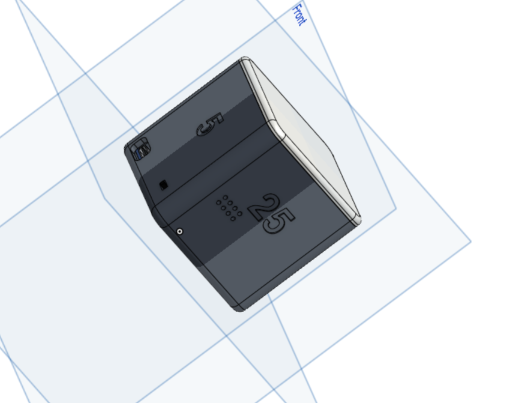
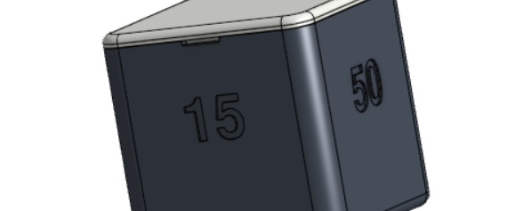
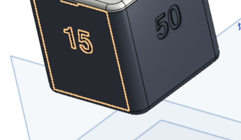
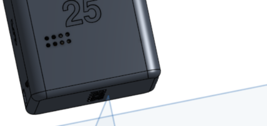
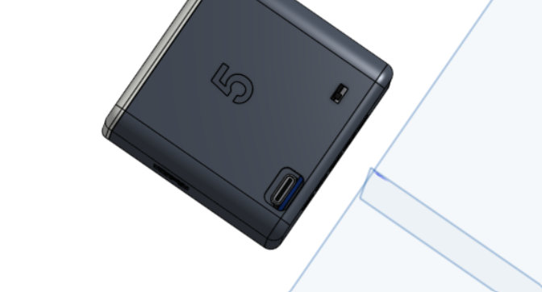
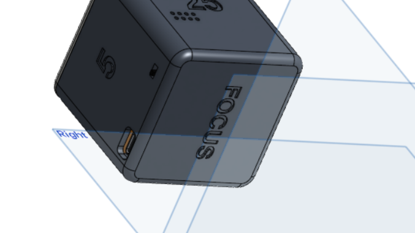
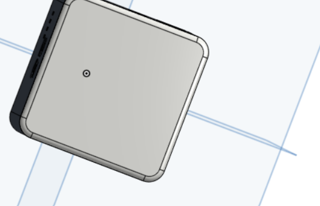

# Focus Totem

A 56 mm cube for running focus sessions. Flip it to begin, and flip it again to see how much time you have left.

## Usage

**Set timer**
- Select your session time by placing the cube on its side with the desired time facing up (5/15/25/50 minutes). The ring will flash to confirm.

**Focus**
- Place the cube upside down with FOCUS showing. The timer will start and the light will be hidden.

**Check time**
- Place the cube upright. The LED ring will show how much time you have left and the timer will pause. Flip the cube again to continue.

When the session is finished, the buzzer will beep.

The cube uses an MPU-6050 accelerometer to determine which side is down. An ESP32-C3 manages the timer and drives the 12-LED WS2812B ring, which shines through a 1 mm white diffuser.

## Parts

| Ref | Part |
| --- | --- |
| U1 | ESP32-C3 SuperMini |
| U2 | GY-521 MPU-6050 |
| D1 | WS2812B 12-LED ring (37 mm) |
| U3 | TP4056 USB-C charger with protection |
| BT1 | 503035 LiPo 500 mAh |
| SW1 | SS12D00G3 slide switch |
| BZ1 | 12095 5 V active buzzer (SS8050 driver) |

These parts come to about $22 on AliExpress (cart prices in November 2026, before shipping). The full BOM with links is in [bom.csv](bom.csv).

## Not in the BOM

The BOM only lists what needs to be bought. It assumes you already have:

- 30 AWG silicone hookup wire (about 1 m)
- Heat-shrink tubing for every joint near the battery
- Kapton tape to insulate the battery tabs
- Double-sided foam tape to hold the battery and modules in place
- Hot glue for the switch, buzzer and LED ring
- A 100 nF ceramic capacitor for the battery-sense divider
- PLA for the body and sled (about 30 g), and white or translucent PLA/PETG for the lid (about 8 g)
- A soldering iron, solder, a multimeter and wire strippers
- 4x M2x6 self-tapping screws, only if the snap-fit lid doesn't hold

## Connections

| Signal | ESP32-C3 pin |
| --- | --- |
| LED ring DIN (via 330 Ω resistor) | GPIO10 |
| MPU-6050 SDA / SCL | GPIO6 / GPIO7 |
| Buzzer (SS8050 base via 1 kΩ resistor) | GPIO5 |
| Battery sense (100 kΩ / 100 kΩ divider) | GPIO3 |

Connect the LiPo to the TP4056 B+/B-. Connect OUT+ to SW1, then SW1 to the ESP32 5V pin. OUT- goes to GND. The LED ring is connected to the same switched rail, with a 330 µF capacitor across the ring's power pins.

## CAD

The enclosure is split into 3 printed parts (files in [cad/](cad)):

- **body** - The body without a top. Print with the open side up and no supports.
- **lid** - Contains the top face and LED diffuser. Print with the top face down using white or translucent material.
- **sled** - The drop-in shelf for the ESP32, MPU and buzzer. Print flat.

`focus_totem_assembly.step` contains all the parts and electronics modelled in their correct positions.

Print with 0.2 mm layers, 3 walls and 15% infill in PLA. The lid is snap-fit. If the lid doesn't stay on when the cube is upside down, add 4x M2x6 self-tapping screws.

| | |
| --- | --- |
|  |  |
|  |  |
|  |  |

## Status

Designed for Hack Club Half Life week 5 (freestyle). Next I will build it and program the firmware.

## Notes

- Flash the ESP32 before putting the case together. There is no external port for the ESP32, so future updates have to be done over Wi-Fi (OTA).
- Don't connect USB to the ESP32 and the charger at the same time.
- Use calipers to measure your modules before printing. Clone boards can vary by roughly 0.5 mm.
